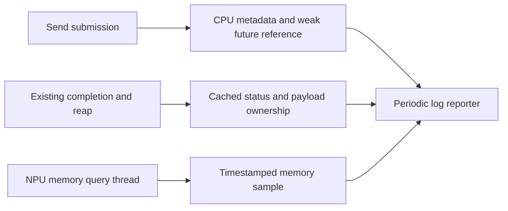

# LWD communication backlog and NPU memory diagnostics

This diagnostic branch starts sampling on every edge and cloud worker after
distributed device initialization. It needs no additional environment variables.
The sampling interval is two seconds. Both scheduling policies use the same
instrumentation.

## Log fields

Search for `[LWD][mem] send role=edge` and `channel=lwd_up` to inspect edge UP
traffic. `pending` counts futures whose completion has not yet been confirmed by
the existing communication code. The reporter never calls `done()`, `wait()`, or
NPU event queries. Consequently, a device operation can finish before the cached
status changes.

`pending_mib` counts the payload bytes retained by those pending futures.
`retained` and `retained_mib` include all tracked futures that still own their send
payload, including completed or failed futures that have not released ownership.
`completed_retained` and `error_retained` separate these cases.

The byte count is the sum of tensor `numel() * element_size()`, including an
optional auxiliary tensor. It describes logical payload ownership, excluding
allocator rounding, original model tensors, HCCL buffers, and other workspaces.
These bytes are already part of device allocation totals; do not add them again.

`oldest_engine`, `oldest_seqno`, `latest_seqno`, and `oldest_age_s` describe pending
send futures. `submitting`, `submitting_mib`, `submit_seqno`, and `submit_age_s`
describe calls still inside submission. A submitting payload may not yet have a
snapshot allocated, so it is reported separately rather than added to retained
bytes. Allocation or submission failures produce `send_submit_error`.

Search for `[LWD][mem] recv_buffer role=edge` with `channel=lwd_down`, or
`[LWD][mem] recv_buffer role=cloud` with `channel=lwd_up`, for receive-future
accounting with the same pending and retained fields. These byte counts use the
actual retained tensor shapes and dtypes. A completed receive can retain a buffer
while its consumer still uses it, so `completed_retained` does not by itself
indicate a leak. The observer also tracks receive submissions in progress and
logs allocation/submission exceptions as `recv_submit_error`.

For pooled receives, frame views can overlap storage already counted by
`device_pool_mib`; use the pool size to budget physical device-slot memory, and
do not add receive-future bytes to it. Queued submissions may not have allocated
their buffers, so their predicted sizes are kept separate from retained bytes.

Search for `[LWD][mem] send role=cloud` and `channel=lwd_down` for the same
accounting of cloud DOWN send snapshots. An unmatched DOWN send retains its
snapshot; additional submitted sends can retain additional snapshots.

Search for `[LWD][mem] recv role=cloud` for cloud UP early-receive accounting.
`inflight` counts posted but not yet published receives, including transfers
awaiting their segmented D2H completion. `queued` counts queued control hints.
`inflight_main_mib` describes logical main-frame sizes of those receives.
`device_pool_mib` is the actual allocated BF16 device-slot capacity, including
idle slots retained for reuse. `slot_limit`, `allocated_slots`, `busy_slots`, and
`slot_owners` describe the pool and its current owners. The two byte counts
overlap and must not be added together. `host_mib` is CPU pinned storage.

`endpoint=False` identifies ranks without cross-machine UP receives. When host
staging is disabled, `device_pool_mib=0` does not mean zero receive allocation;
there is no device-slot pool in that mode. `recv_lock_busy=True` or
`stage_lock_busy=True` marks a snapshot that could not read the corresponding
accounting lock immediately. Its `-1` values mean unavailable, not empty. The
reporter never waits behind the receive path's buffer allocation.

Search for `[LWD][mem] device role=edge` or `[LWD][mem] device role=cloud` for each
worker's memory sample. `hbm_free_mib` and `hbm_total_mib` are device-wide Runtime
memory values. `allocated_mib`, `reserved_mib`, `peak_allocated_mib`,
`allocation_retries`, and `ooms` are process-local allocator statistics. A value
of `-1` means unavailable, not zero free memory.
`active_mib` includes active allocations awaiting safe stream reuse;
`inactive_split_mib` reports inactive split blocks in the allocator.

`memory_age_s` measures the age of the cached device sample. Device memory queries
run independently of the reporter so a stalled Runtime query cannot suppress
CPU backlog logs. An increasing `query_running_s`, old `memory_age_s`, or
`query_error` makes the cached memory unsuitable for describing current free HBM.
`sample` joins send and memory lines within the same worker. `wall` is Unix time;
`ts` is the local monotonic clock and must not be subtracted across machines.

## Interpretation

Compare a startup baseline, backlog growth, and the first stall. Growing edge UP
retained bytes accompanied by rising allocation and falling available HBM
supports send-backlog memory pressure. A large reserved/allocated gap can instead
mean memory remains in the allocator cache. Correlation alone does not establish
that memory pressure caused the earlier communication stall. An allocator OOM,
failed allocation, or corresponding device evidence is needed to establish
exhaustion. Short peaks between samples can be missed; the allocation peak and
OOM/retry counters provide additional evidence.

The observer keeps weak send/receive future references and scalar metadata only. It neither
reaps communication work nor changes send limits, stream dependencies, scheduler
quotas, or communication timeouts. Hardware validation and performance comparison
remain necessary on the actual NPU deployment.

## CPU validation and review

The temporary validation script is outside the repository test tree. Its cases
and purposes are listed for human review:

| Case | Purpose |
| --- | --- |
| 61 full UP batches | Verify 61 retained BF16 payloads account for 4880 MiB. |
| Completed then reaped | Distinguish confirmed completion from payload release. |
| Auxiliary payload | Avoid duplicate counting and preserve remaining aux bytes. |
| Error with ownership | Distinguish failed retained work from pending work. |
| Weak metadata | Verify the observer does not keep futures or tensors alive. |
| Reused object identity | Avoid losing a new future behind an expired record. |
| Submission failure | Separate submitting bytes and preserve failure metadata. |
| Service integration | Preserve the original exception, recv path, and shutdown. |
| Memory statistics | Preserve values and mark unavailable fields as -1. |
| Blocked memory query | Continue CPU backlog reporting while the device query waits. |
| Failed memory query | Preserve the last sample and expose its age and query error. |
| Cloud DOWN send | Verify cloud send ownership reaches the periodic send log. |
| Cloud UP pool | Separate queued hints, logical frames, device pool, and host storage. |
| Idle pool | Include allocated idle device slots in the pool memory total. |
| Busy pool lock | Return immediately while an allocation owns the pool lock. |
| Busy receive lock | Report unavailable receive counts without losing pool accounting. |
| Busy stage lock | Preserve receive counts while marking pool accounting unavailable. |
| Non-endpoint rank | Report no cross-machine receive pool for other TP ranks. |
| Receive log integration | Verify cloud receive metadata reaches the periodic reporter. |
| Edge DOWN buffer | Verify one 20480-element BF16 receive accounts for 40 KiB. |
| Completed receive | Preserve retained bytes until the receive consumer releases ownership. |
| Borrowed receive view | Avoid counting the same tensor twice through future and request references. |
| Receive submission error | Preserve the original exception and record the affected sequence. |
| Concurrent submission types | Keep send and receive submission counts separate. |

All 24 temporary cases and the existing 9 edge-worker, 4 cloud-worker, and 43
host-staging CPU tests passed. The repository test files are unchanged. The new module passes
Ruff check and format; comparison with HEAD found no introduced Ruff diagnostics
in the touched files. The repository's `bash format.sh ci` / pre-commit checks
were run in an isolated copy to preserve the working tree and test files.
Full-repository checks failed on existing lint, spelling, Markdown, filename,
logger/import violations and a missing shellcheck executable. The new diagnostic
module and document introduced no reported lint or spelling violations.
No NPU execution or performance validation has been performed.

The intent comments and docstrings requiring human review explain why metadata
must use weak references, why device-memory queries run separately from the
reporter, and why receive snapshots acquire accounting locks without waiting.
